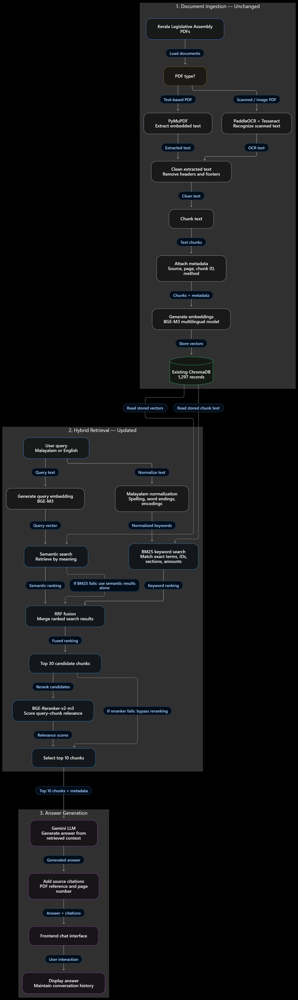

# Niyamadarshini

**Niyamadarshini** is an AI-powered legislative document intelligence system designed to make Kerala Legislative Assembly laws, rules, and proceedings **searchable, understandable, and accessible** to citizens, students, researchers, and judiciary staff.
By combining **Retrieval-Augmented Generation (RAG)**, **multilingual embeddings**, and **hybrid retrieval**, the system transforms complex legislative PDFs (Kerala Government Gazettes, orders, rules and notifications) into a conversational knowledge platform.

> This is an information-retrieval assistant, not a substitute for professional legal advice.

#### Loom Demo: [Demo](https://www.loom.com/share/e55a2011a8014b719871107eb803938d)
#### Evals: [niyamadharshini-evals](https://niyamadharshini-docs.vercel.app/)

## Solution Overview

Niyamadarshini converts legislative documents into structured, searchable knowledge units and enables users to ask questions in **Malayalam and English** to receive **clear, cited answers** with document and page references.
The system uses AI not as a knowledge source, but as a **reasoning engine grounded in official documents**.


## How It Works

```text
PDF files (ingestion, offline)
  -> PyMuPDF text extraction, PaddleOCR/Tesseract fallback for scanned pages
  -> Malayalam-safe text cleaning -> chunking (1000 chars, 200 overlap)
  -> BAAI/bge-m3 embeddings -> ChromaDB persistent vector store

User question (online)
  -> Dense:   bge-m3 query embedding -> top 30 ChromaDB matches
  -> Lexical: Malayalam-aware BM25 over the same chunks -> top 30 matches
  -> Reciprocal Rank Fusion (RRF) of the two ranked lists
  -> Cross-encoder reranking of the top 30 (BAAI/bge-reranker-v2-m3, int8)
  -> Top 10 chunks -> Gemini (gemini-2.5-flash) answer with source pages
```

The prompt instructs Gemini to use only the retrieved context, explain the legal meaning in simple language, and answer in the language of the question.

## Architecture

Three stages: document ingestion (unchanged), hybrid retrieval (semantic search + Malayalam-aware BM25, fused with RRF and reranked), and answer generation with Gemini. Dashed arrows are fallbacks: if BM25 fails, semantic results are used alone; if the reranker fails, it is bypassed. Details in [Retrieval](#retrieval).

<p align="center">
  
</p>

## Tech Stack

- **Backend:** Python, Flask, Flask-CORS, python-dotenv
- **Retrieval:** ChromaDB 1.5.5, SentenceTransformers (`BAAI/bge-m3`, `BAAI/bge-reranker-v2-m3`), BM25 implemented in-repo (NumPy)
- **Answer generation:** Google Gemini API (`gemini-2.5-flash` by default)
- **Frontend:** plain HTML/CSS/JavaScript, Marked.js for Markdown, browser `localStorage` for chat history
- **Ingestion:** PyMuPDF, PaddleOCR, Tesseract (Malayalam + English), LangChain text splitter

## Project Structure

```text
api.py                     Flask app: /api/ask, chat UI, PDFs, /evals viewer, Gemini call
retrieval/                 Hybrid retrieval layer
  config.py                All retrieval settings (overridable via .env)
  tokenizer.py             Malayalam/English normalization + BM25 tokenizer
  bm25_index.py            Persistent BM25 index synced from ChromaDB
  fusion.py                Reciprocal Rank Fusion
  reranker.py              Cross-encoder reranker (optional int8)
  hybrid.py                Dense + BM25 -> RRF -> rerank orchestration
frontend/
  index.html               Chat interface
scripts/
  ingest_pdfs.py           PDF ingestion pipeline (extract -> clean -> chunk -> embed -> store)
  ocr_extract.py, clean_text.py, chunk_text.py, embed_store.py
  build_bm25_index.py      Build / sync / check the BM25 index
  chat.py                  Terminal chat client (same pipeline as the web app)
eval/
  golden_set.jsonl         20 golden questions with verified evidence
  build_golden_set.py      Resolves evidence passages to gold chunk IDs
  evaluate_retrieval.py    A/B/C retrieval evaluation + answer generation
  verify_collection.py     Fingerprints the ChromaDB collection (integrity check)
  build_report_data.py     Exports results to docs/data.json for the report page
  serve_report.py          Serves the report at http://localhost/evals
  results/                 Saved evaluation runs (shown at /evals)
tests/                     Unit tests (no models or API keys needed)
docs/                      Evaluation report: a static site, deployable on its own
  index.html               Report page (also served by the app at /evals)
  data.json                Results data (generated)
  architecture.png         Architecture diagram
requirements.txt           App, retrieval, evaluation and tests
requirements-ingest.txt    Extra packages for PDF ingestion
```

Not in the repository (gitignored): `data/` (source PDFs), `chroma_db/` (vector store), `bm25_index/` (generated), `.env`.

## Setup

```powershell
python -m venv .venv
.\.venv\Scripts\Activate.ps1          # Linux/macOS: source .venv/bin/activate
pip install -r requirements.txt
copy .env.example .env                # Linux/macOS: cp .env.example .env
```

Edit `.env` and set your Gemini API key (from <https://aistudio.google.com/apikey>):

```text
GEMINI_API_KEY=your_gemini_api_key
```

Never commit `.env`. If a key is ever committed or shared, revoke it and create a new one.

The first start downloads the embedding and reranker models (about 4.5 GB) from Hugging Face. Running the app needs roughly 5 GB of free RAM.

## Ingest Documents

Ingestion is only needed to add PDFs; it needs the extra packages and a Tesseract install with Malayalam data on `PATH`:

```powershell
pip install -r requirements-ingest.txt
python scripts\ingest_pdfs.py
```

Place PDFs directly in `data\`. Defaults: chunk size 1000 characters, overlap 200, minimum chunk 200, collection `malayalam_docs` in `chroma_db`. PDFs already in the collection are skipped. The BM25 index syncs automatically on the next app start (or run `python scripts\build_bm25_index.py`).

## Run

```powershell
python api.py
```

- Chat: <http://localhost:8000>
- Evaluation results: <http://localhost:8000/evals>
- Health check: <http://localhost:8000/api/health>

Terminal chat with the same pipeline: `python scripts\chat.py` (type `exit` to quit).

## Security

- By default the server listens on `127.0.0.1` only (this computer). To use it from other devices, set `FLASK_HOST=0.0.0.0` **and** `APP_PASSWORD` in `.env`; the browser then asks for the password (any username) on every page, API call and PDF. `/api/health` stays open.
- Cross-origin requests are blocked unless you list allowed sites in `CORS_ORIGINS`.
- Keep `FLASK_DEBUG=false` on any shared machine: debug mode exposes an interactive debugger.
- Answers are rendered from Markdown and sanitized with DOMPurify; user text, chat titles and source names are escaped. Marked and DOMPurify are pinned with Subresource Integrity hashes.
- The Flask development server is meant for local use. For a public deployment, run behind a production WSGI server and HTTPS (Basic auth sends the password unencrypted over plain HTTP).

## Retrieval

The original system used dense (semantic) search only. Retrieval is now hybrid, built on top of the existing ChromaDB collection without modifying it: no PDFs were re-processed, no chunks or embeddings were changed.

**Dense search** is unchanged: the `bge-m3` query embedding is searched against the existing collection.

**BM25 lexical search** catches exact wording that embeddings miss, such as order numbers (`18/Leg.C3/2024/Law`, `79/ലെഗ്‌.സി3/2025/നിയമം`), section numbers, amounts and defined terms. The tokenizer is designed around the actual corpus:

- Legacy chillu encoding (consonant + virama + ZWJ, used throughout the gazettes) and atomic chillus (typed on modern keyboards) are normalized to the same form; ZWJ/ZWNJ, Malayalam digits and legacy-font spellings (`ളള` → `ള്ള`) are normalized too.
- Malayalam is agglutinative (`നികുതി`, `നികുതിയുടെ`, `നികുതിയും` ...), so every Malayalam word also emits a 5-character prefix feature that matches its inflected forms.
- Legal identifiers and dates are indexed whole and by their parts. English is lowercased only; no English stemming or stop-word removal.

On the golden set, a naive whitespace BM25 found the right chunk for 8 of 17 questions; this tokenizer finds 15 of 17.

The BM25 index is stored in `bm25_index/` as term frequencies and content hashes keyed by ChromaDB chunk ID (no copy of the text). It is synced incrementally on startup (added, changed and removed chunks), rebuilt automatically if missing or built with a different tokenizer, and can be managed manually:

```powershell
python scripts\build_bm25_index.py            # incremental sync
python scripts\build_bm25_index.py --check    # report drift, write nothing
python scripts\build_bm25_index.py --rebuild  # rebuild from ChromaDB
```

**Reciprocal Rank Fusion** combines the two ranked lists by rank, `score(d) = Σ 1 / (k + rank)`, so BM25 scores and vector distances never have to be compared directly. Candidates are deduplicated by chunk ID.

**Reranking.** `BAAI/bge-reranker-v2-m3` scores the question against each of the top 30 fused candidates and reorders them. It was chosen because it is Apache-2.0 licensed, multilingual, and built on the same XLM-RoBERTa / bge-m3 backbone as the embedding model, whose pretraining covers Malayalam. Its model card does not list Malayalam explicitly, so its benefit was measured rather than assumed (see [Evaluation](#evaluation)). On CPU it runs with dynamic int8 quantization, which is 2.4× faster than full precision for nearly the same accuracy. If the model cannot load, retrieval falls back to the fused ranking.

Every stage degrades instead of failing: if BM25 is unavailable the app uses dense search, if dense search fails it uses BM25, and if the reranker fails it uses the fused ranking. Only chunk IDs, counts and timings are logged, never question or document text.

### Retrieval settings

All settings are optional `.env` variables (see `.env.example`):

| Variable | Default | Meaning |
|---|---|---|
| `RETRIEVAL_MODE` | `hybrid` | `hybrid`, `dense` (original behaviour) or `bm25` |
| `DENSE_TOP_K` / `BM25_TOP_K` | `30` | Candidates from each retriever |
| `RRF_K` | `60` | RRF smoothing constant |
| `FINAL_TOP_K` | `10` | Chunks sent to the LLM |
| `RERANK_ENABLED` | `true` | Turn the cross-encoder on or off |
| `RERANK_CANDIDATES` | `30` | Fused candidates the reranker scores |
| `RERANK_QUANTIZE` | `int8` | `int8` on CPU, or `none` for full precision |
| `RERANKER_MODEL` | `BAAI/bge-reranker-v2-m3` | Any sentence-transformers CrossEncoder |
| `BM25_INDEX_PATH` | `bm25_index/malayalam_docs.json.gz` | Index file location |
| `LLM_MODEL` | `gemini-2.5-flash` | Answer-generation model |

Server settings (`FLASK_HOST`, `FLASK_PORT`, `FLASK_DEBUG`, `APP_PASSWORD`, `CORS_ORIGINS`) are described in [Security](#security) and `.env.example`.

## Evaluation

`eval/golden_set.jsonl` holds 20 questions written against the indexed corpus: 17 answerable (factual, legal identifiers, sections, paraphrases, multi-chunk) and 3 unanswerable, in English (12), Malayalam (6) and mixed language (2). Each answerable question lists verbatim evidence passages; `eval/build_golden_set.py` resolves them to every chunk containing them, so gold chunk IDs come from the corpus rather than being typed by hand. English and Malayalam versions of the same provision count as one evidence fact.

Results on the 17 answerable questions (top-10 context, as sent to the LLM):

| Configuration | Right chunk at #1 | In top 5 | In top 10 | Recall@10 | MRR@10 | Retrieval time |
|---|---|---|---|---|---|---|
| A · Dense only (original) | 8/17 | 14/17 | 15/17 | 0.624 | 0.579 | 0.2 s |
| B · Hybrid (dense + BM25, RRF) | 10/17 | 14/17 | 16/17 | 0.484 | 0.687 | 0.2 s |
| C · Hybrid + rerank, full precision | 13/17 | 16/17 | 17/17 | 0.720 | 0.832 | 24.9 s |
| **C · Hybrid + rerank, int8 (default)** | **13/17** | **15/17** | **16/17** | **0.700** | **0.809** | **10.5 s** |

Retrieval times were measured on an 8-core laptop CPU without a GPU. The saved evaluation answers were generated with Claude Sonnet 5.5 during a temporary switch; the app now uses Gemini 2.5 Flash, so regenerate answers with `--generate-only` to review Gemini's output.

- Reranking gives the largest gain: the right chunk is ranked first for 13 questions instead of 8, mostly on English questions (2/10 → 6/10). Malayalam questions were already 5/5 at rank 1 with dense search.
- Hybrid search without reranking ranks better than dense search but has lower recall, because BM25 hits displace some chunks dense search had found.
- The top reranker score separated the 3 unanswerable questions (≤ 0.08) from all answerable ones (≥ 0.27). This is not used yet; 3 questions are too few to set a threshold.

**Limits of this benchmark.** 20 questions is an initial comparative benchmark, not a measure of production accuracy; a difference of one or two questions is within noise. The gold labels were derived from verbatim corpus passages but have not been reviewed by a legal expert. These numbers measure retrieval only; answer quality (correctness, faithfulness, citation support, abstention) is reviewed manually.

### Running the evaluation

Stop the app first: the evaluation loads the same models.

```powershell
python eval\evaluate_retrieval.py                     # A/B/C retrieval metrics
python eval\evaluate_retrieval.py --sweeps            # + tokenizer, depth, RRF k, rerank depth sweeps
python eval\evaluate_retrieval.py --generate-only eval\results\<run>   # answers with the app's prompt and model
python eval\evaluate_retrieval.py --score-review eval\results\<run>\manual_review.csv
python eval\build_golden_set.py                       # verify gold labels still match the corpus
python eval\verify_collection.py --save baseline.json # fingerprint ChromaDB; --compare baseline.json later
```

Each run is saved to `eval/results/<run>/` (`retrieval.json`, `answers.json`, `summary.md`, and `manual_review.csv` for scoring answers by hand). The report page shows every run with a cross-run comparison, per-question results, and the generated answers.

### Evaluation report

The `docs/` folder is a self-contained static site: `index.html` (the report page) and `data.json` (the results, exported by `python eval/build_report_data.py`, which runs automatically after every evaluation). It needs no Python, models or API key. Three ways to view it: [Evaluation](https://niyamadharshini-docs.vercel.app/)


The deployed report is a snapshot: commit and push after new evaluation runs to update it.

## Tests

```powershell
python -m unittest discover -s tests -t .
```

The unit tests (53) cover the tokenizer, BM25 persistence and incremental sync, RRF, the hybrid retriever's fallbacks, configuration, and the Gemini request and safety-block handling. They use in-memory fakes and need no models, database or API key.

## API

### `POST /api/ask`

```json
{ "question": "What does this government order say?" }
```

Response:

```json
{
  "answer": "## Government Order\n\n...",
  "sources": [
    {
      "pdf": "gazette.pdf",
      "page": "4",
      "distance": 0.231,
      "relevance": 0.8845,
      "chunk_id": "gazette.pdf_p4_17",
      "rerank_score": 0.412
    }
  ]
}
```

- `distance`: ChromaDB `l2` distance (squared Euclidean on unit vectors, `2 - 2·cosine`).
- `relevance`: embedding cosine similarity (0–1), shown in the UI.
- `chunk_id`: stable ChromaDB record ID of the cited chunk.
- `rerank_score`: present only when reranking ran; orders the list but is not a calibrated probability.

### `GET /api/health`

```json
{ "status": "ok", "message": "Niyamadharshini API is running" }
```

## Frontend Features

- Malayalam and English questions, Markdown answers
- Source links with PDF names and page numbers
- Dark/light theme, chat history in the browser (`localStorage`), copy-answer button
- Casual greetings handled locally without an API request

## Troubleshooting

- **`memory allocation ... failed` or the server exits silently while loading:** the models need about 5 GB of RAM. Close memory-heavy applications, or start without the reranker: set `RERANK_ENABLED=false` in `.env` (hybrid search still works).
- **Connection refused:** check that `python api.py` is still running and open <http://localhost:8000/api/health>.
- **Collection not found:** run ingestion first; the app expects the ChromaDB collection `malayalam_docs`.
- **Gemini errors or quota errors:** check `GEMINI_API_KEY`. The SDK retries rate-limit (429) and server errors (5xx) automatically; if the daily free-tier quota is used up, wait for the reset or enable billing. Newer Google projects may not have access to `gemini-2.5-flash`; set `LLM_MODEL` to a model your key supports. If Gemini blocks a question for safety or recitation, the app answers "This question could not be answered".

